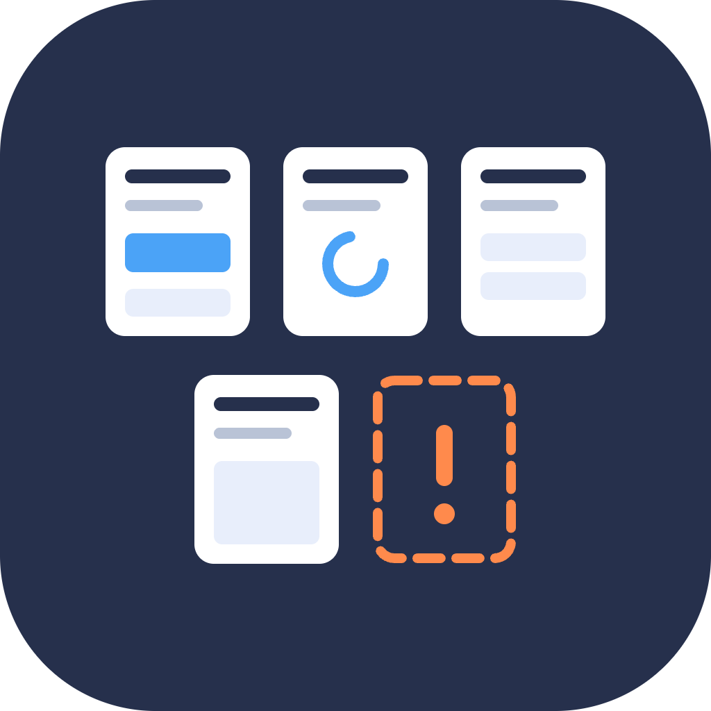
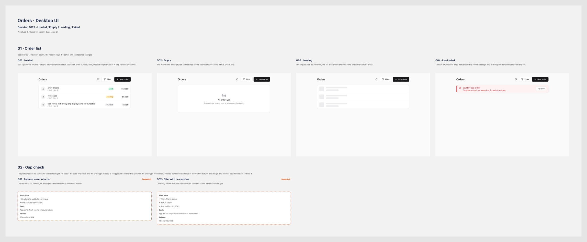
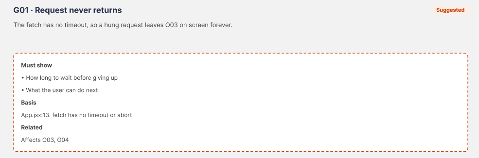

<p align="center"></p>

# code-to-figma-ui-states

**Find the error, empty and loading screens your prototype forgot, then see every state of the feature on one Figma canvas.**

[](https://github.com/byby325/code-to-figma-ui-states/actions/workflows/test.yml)
[](CHANGELOG.md)
[](LICENSE)


English · [繁體中文](README.zh-TW.md)



<sub>Built from [`examples/orders-demo`](examples/orders-demo): four states found in the code, and two gaps flagged with the line that shows why.</sub>

<!-- TODO: 30–45 s demo video — repo → agent shows the state matrix → the board appears in Figma -->

A feature has many more states than its mockups show: loading, empty, failed, no permission, a name too long for its box, an overdue badge. Engineers meet them in code; designers find out in QA. This plugin reads the feature's code, lists every state it can be in, and runs a **gap check** for the ones nobody handled. Then it rebuilds each state in Figma from the real running app and lays them all out on one board.

Works with **React** (including Next.js Server Components) and **Vue** apps.

| Before | After |
|---|---|
| A mockup of the happy path, and a ticket that says "handle errors" | An inbox page in a real HR app: **15 states** found in code and captured from the running app, plus **4 gaps** flagged with the reason and the line of code, e.g. *"load failure has no retry: `LoadState.vue:21` only shows the message"* |
| Designers guess which states exist | Designers, engineers, QA and PMs review the same list: every card says *trigger; result* |
| Missing screens surface in QA | Missing screens are wireframes on the board before anyone writes the fix |

## What you get

| Skill | What it does | Use it alone when |
|---|---|---|
| `state-discovery` | Reads the code (and spec, if any) and lists every screen state as a matrix: what the prototype handles, what the spec requires, what's missing | You only need the state list. No Figma needed |
| `code-to-figma` | Runs your web app, captures each state, and rebuilds it as **native Figma layers**: Auto Layout, components, variants. Then diffs it against the browser | You want real screens in Figma, not a screenshot |
| `figma-state-board` | The whole flow: inventory → board skeleton → screens → gap check → audit | You want the full state board |
| `figma-library-binding` | Binds the result to your design system: tokens only on exact matches, library icons and components, unmatched values listed for a designer | Your Figma has a published library |



Each card on the board says **trigger; result** ("API returns 403; lock icon, explanation and a back link"), so designers, engineers, QA and PMs read the same list. Gap cards are wireframes that say what the screen must explain and **why it's flagged**, with a file and line number.

## Quick start

**Claude Code**

```text
/plugin marketplace add byby325/code-to-figma-ui-states
/plugin install code-to-figma-ui-states@code-to-figma-ui-states
```

**Codex**: run `/plugins`, add the `byby325/code-to-figma-ui-states` marketplace, install `code-to-figma-ui-states`.

**Other agents (Cursor, Gemini CLI and more)**, as plain skills with the [`skills`](https://skills.sh) CLI:

```bash
npx skills add byby325/code-to-figma-ui-states
```

Install all four skills together: they link to each other, so one on its own is missing the files it points to.

**Or paste this into your agent:**

```text
Install the code-to-figma-ui-states plugin from github.com/byby325/code-to-figma-ui-states (marketplace "code-to-figma-ui-states", plugin "code-to-figma-ui-states"), then tell me to restart the session.
```

### Try it on the demo app

No project at hand? [`examples/orders-demo`](examples/orders-demo) is a small React orders page with four states and two unhandled ones. Clone the repo, run `npm install` and `npm run dev` in that folder, and use the prompts in its README.

### Try it without Figma

The state inventory needs no Figma account and no MCP calls. Restart the session, open your project and ask:

```text
List every state of the inbox page and the error handling it's missing
```

You get a state matrix: each state with its trigger, what the screen shows, and the file and line it comes from, followed by the gaps.

### Make a board

```text
Make a state board for the checkout page in app/checkout/page.tsx, in this Figma file: <link>
Turn /settings into editable Figma layers
```

It checks it can write to the file, estimates the Figma MCP calls the job needs, shows you the state matrix, and waits for your OK before drawing anything.

### On a free Figma plan

Free plans get about 20 Figma MCP calls a month, which is not enough to rebuild a board's screens as layers. Ask for screenshots instead:

```text
Make a state board for the checkout page with browser screenshots in the cards, in this Figma file: <link>
```

The board, the gap check and the wireframes are the same. Each card shows a 2x screenshot of the running app instead of editable layers, and the whole board takes about 3 calls however many states it has. Any card can be rebuilt as layers later.

## Requirements

- Claude Code or Codex, with the [Figma MCP server](https://developers.figma.com/docs/figma-mcp-server/) connected. The signed-in account needs **edit** access to the target file
- **Figma MCP call budget.** Starter plans and View/Collab seats get about 20 calls a month; Full/Dev seats on paid plans get 200+ a day. A state board with rebuilt screens needs roughly `screens × 2 + 5` calls; one with browser screenshots needs about 3. The skill estimates this up front and tells you if it won't fit
- To rebuild screens from code: a web app you can run in dev mode (React 18–19 or Vue 3 for component detection), Node 18+, Playwright (uses your local Chrome; nothing else to download), Python 3 with Pillow for the visual diff

## How it works

1. **Inventory.** Walks the feature's code (`v-if`, loading/error branches, permission checks, empty lists, API error codes) and the spec, then checks a gap list: loading, empty, network, auth, validation, business rules, data extremes, concurrency, feedback. Every state points to a file and line
2. **You confirm the matrix.** Merge cards, drop suggestions, then it draws
3. **Capture.** Runs your dev server and drives each state with your existing mocks, e2e fixtures, or by intercepting API responses, so no repo changes are needed
4. **Rebuild.** Extracts a layout tree from the DOM (direction, gap, padding, alignment, component boundaries) and builds it with the Figma Plugin API as Auto Layout frames, components and instances, one screen at a time to keep file memory safe. On a small call budget it puts browser screenshots in the cards instead
5. **Board.** One script lays out the section, groups, cards and gap wireframes from the matrix
6. **Audit.** Structural checks plus a pixel diff against the browser for each screen. It tells you what was compared and what wasn't

## What's verified

- **Vue 3:** five projects rebuilt in Figma and diffed against the browser: SCSS, Tailwind, Playwright fixtures, Nuxt (full page) and frappe-ui (oklch colors, CSS-mask icons, intercepted APIs)
- **React 18 and 19:** component detection is tested against real React (function and class components, `memo`, `forwardRef`, Radix `asChild`, providers, styled-components, production builds) and on two apps: Vite + Radix + Tailwind 4, and Next.js App Router, where Server Component names come through too. The Vite app is rebuilt in Figma and diffed against the browser (four screens, 0.02–0.12% different); the Next.js app is verified up to capture

- **Screenshot boards (0.8.0):** run end to end in a real Figma file on a free Starter plan: a React orders page with four states and two gap cards, built and audited in 2 counted calls

Baselines are in [`evals/trials.json`](skills/code-to-figma/evals/trials.json).

Not yet: component boundaries for Svelte, Angular and others (repeated structures are still detected), native apps, canvas-drawn UIs. Known limits, such as `clip-path` and Figma's lack of tabular numbers, are listed in [`code-to-figma/SKILL.md`](skills/code-to-figma/SKILL.md).

## FAQ

**Figma can already bring code into the canvas. Why this?** Figma's own tools (and its official agent skills) bring in the page you point them at. This plugin starts one step earlier: it works out *which* states the feature has from the code, including the ones the prototype never renders, and puts them side by side with a gap check. The screens it builds are Auto Layout and components, with repeated UI as instances and states as variants. It also works with Figma's official skills: when they're installed, it uses them for the Plugin API rules.

**How is this different from importing a screenshot or HTML into Figma?** Those give you a picture or flat layers of one screen. This builds editable structure and covers *every state* of the feature.

**I'm on a free Figma plan. Can I use it?** Yes. The state inventory needs no Figma at all, and a board with browser screenshots in its cards fits in the free plan's monthly calls. Rebuilding every screen as editable layers needs a Full or Dev seat on a paid plan.

**Will it overwrite my designs?** No. It adds a new section and never edits existing frames. Before writing to a file that already has content, it asks you to save a version.

**Does it need my backend running?** No. It can capture against your mocks, fixtures, or saved API responses.

**Does it work with Next.js and shadcn/ui?** Yes. Run `next dev` (production builds strip component names). Client and Server Components both get their names on React 19 (Next 15+). Wrappers that only pass children through, like `TooltipTrigger asChild` or a theme provider, don't steal the name from the `Button` inside them.

**Is the board in English?** It follows your language. Boards come in English or Traditional Chinese: the fixed labels (In spec, Suggested, Gap check, the coverage summary) switch with `BOARD.lang`, and the card text is written in whatever language you work in. In other languages the fixed labels stay English. The skill instructions themselves are in English.

## Development

```bash
npm install && npm test
```

The tests need no Figma account: a fake Figma runs the board script through the audit, and Chrome runs the DOM extractor against a test page. See [CONTRIBUTING.md](CONTRIBUTING.md) and [CHANGELOG.md](CHANGELOG.md).

## License

[MIT](LICENSE) © Dilly Chen
