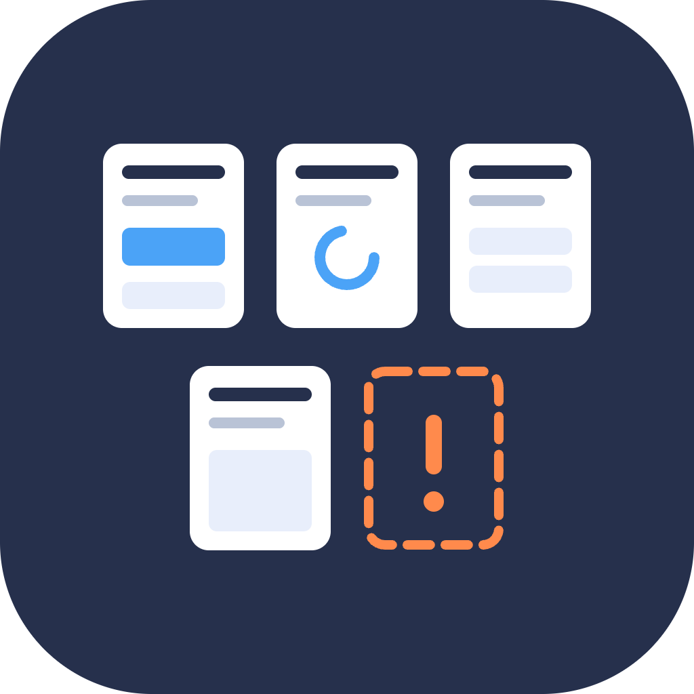

<p align="center"></p>

# figma-state-board

**找出原型漏掉的錯誤、空狀態和載入畫面，再把功能的所有狀態攤在同一張 Figma 畫布上。**

[](https://github.com/byby325/figma-state-board/actions/workflows/test.yml)
[](CHANGELOG.md)
[](LICENSE)


[English](README.md) · 繁體中文

<!-- TODO：30–45 秒的展示：repo → agent 給出狀態矩陣 → Figma 情境稿上的藍、橘缺漏標籤（docs/demo.gif） -->

一個功能的狀態，遠比設計稿畫的多：載入中、沒有資料、載入失敗、沒有權限、名字太長塞不下、逾期的標示。工程師在程式裡碰到，設計師到了 QA 才知道。這個 plugin 讀功能的程式碼，列出它所有會發生的狀態，並做一次**缺漏檢查**，找出沒人處理的狀態；再用真的跑起來的畫面，在 Figma 逐一重建，全部攤在同一張情境稿上。

支援 **React**（含 Next.js 的 Server Component）和 **Vue** 專案。

| 以前 | 用了之後 |
|---|---|
| 一張正常流程的設計稿，加上一張寫著「要處理錯誤」的 ticket | 一個真實 HR 系統的待辦頁：從程式碼找出 **15 個狀態**，都從跑起來的畫面抓下來；另外列出 **4 個缺漏**，附原因和程式行號，例如「載入失敗沒有重試：`LoadState.vue:21` 只顯示訊息」 |
| 設計師用猜的，不知道有哪些狀態 | 設計師、工程師、QA、PM 看同一份清單，每張卡都寫「觸發條件；畫面結果」 |
| 缺的畫面到 QA 才發現 | 修之前，缺的畫面就已經是情境稿上的線框 |

## 有哪些 skill

| Skill | 做什麼 | 單獨使用的時機 |
|---|---|---|
| `state-discovery` | 讀程式碼（有規格的話一起讀），把所有畫面狀態列成矩陣：原型有做的、規格有寫的、缺漏的 | 只要狀態清單，不碰 Figma |
| `code-to-figma` | 跑起專案，抓下每個狀態，重建成 **Figma 原生圖層**：Auto Layout、component、variant，再跟瀏覽器截圖比對 | 要真的畫面進 Figma，不是截圖 |
| `figma-state-board` | 完整流程：盤點 → 板面骨架 → 建畫面 → 缺漏檢查 → 驗收 | 做完整情境稿 |
| `figma-library-binding` | 綁到專案的 design system：數值完全相同才綁 token，圖示和元件換成 library 版本，對不到的值列給設計決定 | Figma 有已發布的 library |

情境稿裡的卡片分三種標記：

- **原型**：原型（通常是 mock data 做的）已經有的狀態，畫真實產品畫面，不加標籤
- **規格有寫**：AC、規格、設計稿或沒用到的 i18n 文案有提到，原型沒做的狀態。畫成線框，放最後的「缺漏檢查」，藍標籤
- **建議補**：規格和原型都沒處理的錯誤、空狀態、載入狀態，依推論列出。畫成線框，放「缺漏檢查」，橘標籤

每張卡都寫成「觸發條件；畫面結果」（例：「API 回 403；顯示鎖頭、說明和返回連結」），設計師、工程師、QA、PM 看的是同一份清單。缺漏卡是線框，寫出這個畫面必須交代的事，以及**為什麼被列出來**，附檔案和行號。section 標題下有覆蓋摘要：「原型 N · 缺漏 N（規格有寫 N · 建議補 N）」。

## 安裝

**Claude Code**

```text
/plugin marketplace add byby325/figma-state-board
/plugin install figma-state-board@figma-state-board
```

**Codex**：輸入 `/plugins`，加入 `byby325/figma-state-board` 這個 marketplace，安裝 `figma-state-board`。

**或把這段貼給你的 agent：**

```text
從 github.com/byby325/figma-state-board 安裝 figma-state-board plugin（marketplace 叫 figma-state-board，plugin 也叫 figma-state-board），裝好後提醒我重開 session。
```

### 不用 Figma 也能先試

狀態盤點不需要 Figma 帳號，也不耗 MCP 呼叫額度。重開 session、打開你的專案，直接說：

```text
盤點待辦頁的所有狀態，列出缺了哪些錯誤處理
```

你會拿到一份狀態矩陣：每個狀態的觸發條件、畫面顯示什麼、出自哪個檔案哪一行，最後是缺漏清單。

### 做情境稿

```text
幫 app/checkout/page.tsx 的結帳頁做情境稿，放到這個 Figma 檔：<連結>
把 /settings 轉成可編輯的 Figma 圖層
```

它會先確認寫得進這個檔、估這次要用多少 Figma MCP 呼叫，再給你狀態矩陣，等你確認才開始畫。

### Figma 免費方案

免費方案每月約 20 次 Figma MCP 呼叫，不夠把整份情境稿的畫面重建成圖層。可以改用截圖：

```text
幫結帳頁做情境稿，卡片裡放瀏覽器截圖就好，放到這個 Figma 檔：<連結>
```

板面、缺漏檢查和線框都一樣，只是每張卡放的是實際畫面的 2 倍截圖，不是可編輯圖層。不管有幾個狀態，整份大約只要 3 次呼叫。之後任何一張卡都可以再重建成圖層。

以前用複製資料夾的方式裝過 skill 的，要把舊的刪掉，不然會有兩個同名 skill：

```bash
rm -rf ~/.claude/skills/figma-state-board ~/.codex/skills/figma-state-board
```

## 需要

- Claude Code 或 Codex，並連好 [Figma MCP](https://developers.figma.com/docs/figma-mcp-server/)。登入的帳號要能**編輯**目標檔。Figma plugin（提供 `figma-use`、`figma-generate-design`）建議一起裝；沒裝時 skill 會用 MCP 的 `get_figma_skill` 讀同樣的指引
- **Figma MCP 呼叫額度**：Starter 方案或 View／Collab 座位每月約 20 次，付費方案的 Full／Dev 座位每天 200 次以上。畫面重建成圖層的情境稿大約要「張數 × 2 + 5」次，卡片放瀏覽器截圖的大約 3 次。開工前 skill 會先估，不夠就先跟你講。細節見 [scale-guard.md](skills/code-to-figma/references/scale-guard.md)
- 從程式重建畫面時：
  - 跑得起 dev 模式的 Web 專案；元件偵測支援 React 18–19 和 Vue 3
  - Node 18 以上
  - Playwright：專案有就用專案的；沒有就在工作目錄 `PLAYWRIGHT_SKIP_BROWSER_DOWNLOAD=1 npm i -D playwright`，直接用本機的 Chrome
  - Python 3；比對工具要 Pillow：`pip install pillow`，或 `uv run --with pillow python al-diff.py …`

## 做情境稿時會發生什麼

1. 先問你程式來源、規格來源（沒有也可以）、目標 Figma、維度與裝置寬度、產品畫面來源。拿到 Figma 連結會先確認讀寫得到，並估這次要用多少 MCP 呼叫。目標頁上已有其他內容時，會請你看目前的 memory 用量
2. 讀程式碼，整理出一份狀態矩陣，**等你確認後才開始畫**。原型卡超過 150 張時，會先請你決定合併卡、拆頁或拆檔
3. 準備每張卡的資料：用專案的 mock、e2e fixture，或攔截後端 API 造出每個狀態，不用改 repo
4. 用骨架腳本一次建好板面：標題、覆蓋摘要、群組、每張卡的占位框，以及缺漏檢查的線框。目標頁上已有其他內容時，會先請你存版本
5. 優先複製 Figma 檔案裡現成的設計稿畫面；沒有設計稿時從專案程式重建，一次一張放進占位框，產出是 Auto Layout＋component，代表畫面附隱藏的瀏覽器參考截圖。有 design system preset 時自動綁 token、圖示和元件。呼叫額度不夠時，改成在占位框放瀏覽器截圖
6. 跑驗收腳本，逐組截圖檢查，最後回報哪些畫面對照過、哪些是示意，以及 node、圖片數、memory 和 MCP 呼叫次數

## 常見問題

**Figma 自己已經能把程式碼帶進畫布，為什麼還要這個？** Figma 的工具（和官方的 agent skill）是把你指定的那一頁帶進來。這個 plugin 往前多做一步：先從程式碼找出這個功能**有哪些狀態**，包括原型從來沒畫出來的，再把它們並排、附上缺漏檢查。建出來的畫面是 Auto Layout 和 component，重複的 UI 是 instance、不同狀態是 variant。有裝 Figma 官方 skill 時，它會沿用那些 skill 的 Plugin API 規則。

**我用 Figma 免費方案，可以用嗎？** 可以。狀態盤點完全不需要 Figma；卡片放瀏覽器截圖的情境稿，用免費方案每月的呼叫額度就做得完。要把每張畫面重建成可編輯圖層，需要付費方案的 Full 或 Dev 座位。

**會蓋掉我的設計稿嗎？** 不會。它只新增 section，不改既有的 frame；目標頁上已有其他內容時，寫入前會先請你存版本。

**情境稿會是中文嗎？** 跟著你用的語言。情境稿有英文和繁體中文兩種：固定的標籤（規格有寫、建議補、缺漏檢查、覆蓋摘要）由 `BOARD.lang` 切換，卡片內容用你工作時的語言寫。skill 的指令本身是英文，用中文下指令一樣可以。

**一定要跑後端嗎？** 不用。可以用專案的 mock、e2e fixture，或存下來的 API 回傳造出每個狀態。

**Next.js、shadcn/ui 可以用嗎？** 可以。跑 `next dev`（production build 會拿掉元件名稱）。React 19（Next 15 起）的 client 和 Server Component 都抓得到名稱。只是把 children 傳下去的包裝層，例如 `TooltipTrigger asChild` 或主題 Provider，不會搶走裡面 `Button` 的名稱。

## 驗證範圍

- **Vue 3**：五種專案在 Figma 重建並和瀏覽器比對過：SCSS、Tailwind、Playwright fixture、Nuxt 全頁，以及 frappe-ui（oklch 色票、CSS mask 圖示、攔截後端 API）
- **React 18、19**：元件偵測用真的 React 測過（function、class component、`memo`、`forwardRef`、Radix 的 `asChild`、Provider、styled-components、production build），也在兩個專案上跑過：Vite + Radix + Tailwind 4，以及 Next.js App Router（Server Component 的名稱也抓得到）。目前驗證到擷取為止，還沒有在 Figma 重建的基準
- **截圖版情境稿（0.8.0）**：在免費 Starter 方案的真實 Figma 檔完整跑過：React 訂單頁的四個狀態加兩張缺漏卡，建板和驗收共用 2 次計額度的呼叫

結果和基準在 [evals/trials.json](skills/code-to-figma/evals/trials.json)。Svelte、Angular 等框架的元件邊界還沒支援（仍會偵測重複結構），原生 App、Canvas 繪製的畫面不適用。已知限制列在 [code-to-figma/SKILL.md](skills/code-to-figma/SKILL.md)。

## 檔案

| 檔案 | 內容 |
|---|---|
| `.claude-plugin/` | Claude Code 的 plugin 和 marketplace 設定 |
| `.codex-plugin/` | Codex 的 plugin 設定 |
| `skills/figma-state-board/` | 六個步驟的總流程、板面規格 `board-format.md`、骨架腳本 `board-skeleton.js`、板面驗收 `audit.js` |
| `skills/state-discovery/` | 各種前端技術去哪裡找狀態、三種卡片標記、缺漏檢查清單、矩陣範例 |
| `skills/code-to-figma/` | 重建流程、畫面結構規範、規模防呆（呼叫額度和 memory）、地雷對照表，以及擷取、重建、比對和驗收腳本；`examples/` 有四種擷取設定範本 |
| `skills/figma-library-binding/` | 綁定規則、`al-bind.js`，`presets/` 放各 design system 的設定（格式見 `presets/README.md`） |
| `tests/` | 不用 Figma 就能跑的測試 |
| 各 skill 的 `agents/openai.yaml` | Codex 介面上的顯示名稱與預設提示 |

## 開發

```bash
npm install && npm test
```

測試不需要 Figma 帳號：模擬的 Figma 跑骨架腳本再交給 audit 驗收，Chrome 跑 DOM 抽取程式。改了版面規格或建構程式，還是要在 Figma 實跑 `evals/trials.json` 的案例。詳見 [CONTRIBUTING.md](CONTRIBUTING.md)、[CHANGELOG.md](CHANGELOG.md)。

## 範例

[checkout-matrix.md](skills/state-discovery/examples/checkout-matrix.md) 是一份狀態矩陣範例（電商結帳）；[board-skeleton.js](skills/figma-state-board/scripts/board-skeleton.js) 最上面的 `BOARD` 是同一個功能的骨架設定。

## 授權

[MIT](LICENSE) © Dilly Chen
