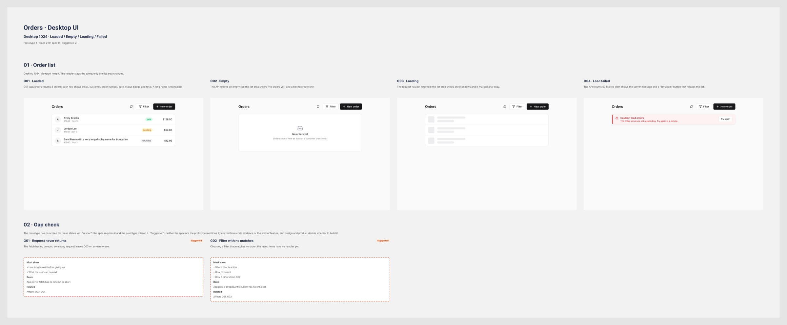

# Orders demo

A small React app to try figma-state-board on: one orders page with four states (loaded, empty, loading, load failed) and a couple of states nobody handled yet. Vite, React 19, Radix, lucide-react and Tailwind 4. There is no backend: the dev server answers `/api/orders` itself.

## Run it

```bash
git clone https://github.com/byby325/figma-state-board && cd figma-state-board/examples/orders-demo
```

```bash
npm install
```

```bash
npm run dev
```

Open http://localhost:5174. Add `?state=empty`, `?state=loading` or `?state=error` to see the other states.

## Try the plugin on it

With the plugin installed, open this folder in Claude Code or Codex.

**No Figma needed:**

```text
List every state of the orders page in src/App.jsx and the error handling it's missing
```

**A state board on a free Figma plan** (browser screenshots in the cards, about 3 Figma MCP calls):

```text
Make a state board for the orders page with browser screenshots in the cards, in this Figma file: <link>. The dev server is running on port 5174 and capture.config.cjs has the four states.
```

**Editable layers** (needs a larger call budget: about 13 calls for the four screens):

```text
Make a state board for the orders page and rebuild the screens as Figma layers, in this Figma file: <link>. The dev server is running on port 5174 and capture.config.cjs has the four states.
```

## What you should get



Four Prototype cards (O01 Loaded, O02 Empty, O03 Loading, O04 Load failed) and a gap check. On our run the gap check flagged two states: the request has no timeout, so a hung request shows the loading skeleton forever (`src/App.jsx`, the `fetch` call), and the Filter menu items do nothing yet, so "filter with no matches" has no screen.

Rebuilt as layers, the four screens came out 0.02–0.12% different from the browser, with `Button`, `Badge`, `OrderRow`, `Skeleton`, `ErrorState` and `EmptyState` as components.

## Files

| File | What it is |
|---|---|
| `src/App.jsx` | The page: fetches orders and picks a state |
| `src/components/States.jsx` | Loading, empty and error states |
| `vite.config.js` | Dev server with the mock `/api/orders` |
| `capture.config.cjs` | The four states for `al-capture.cjs`; set `SHOT_ONLY=1` for screenshots only |
